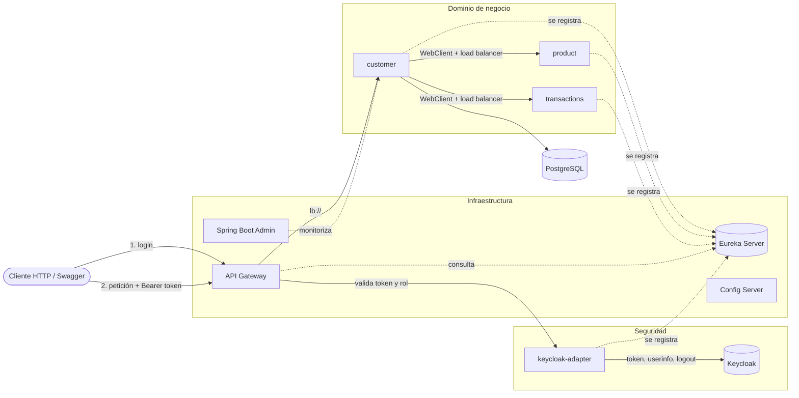

# PaymentChain: plataforma de microservicios con Spring Boot, API Gateway y Keycloak


PaymentChain es un sistema de microservicios que simula el núcleo de una plataforma de pagos: gestión de clientes, catálogo de productos y transacciones. El acceso se hace a través de un **API Gateway** que exige un token de **Keycloak** (OAuth2 / JWT) y comprueba el rol del usuario antes de dejar pasar la petición.

Está construido con **Spring Boot** y **Spring Cloud**, y se empaqueta y orquesta con **Docker** y **Docker Compose**. Es el resultado práctico del curso [Microservicios y APIs REST con Spring Boot, OAuth2 y Docker](https://www.udemy.com/course/microservicios-spring-boot-cloud-docker-profesional/) de Udemy.

## Qué hace

- Un **cliente** (`customer`) tiene asociados varios **productos** y un IBAN.
- Al consultar un cliente en detalle, `customer` llama por HTTP a `product` (nombre de cada producto) y a `transactions` (movimientos de su IBAN), y devuelve todo en una sola respuesta.
- Al crear un cliente se valida que los productos indicados existan. Si no, la API responde con un error de negocio.
- Los servicios se descubren entre sí con **Eureka**, sin direcciones fijas.
- El **API Gateway** es el punto de entrada: valida el token, comprueba el rol y enruta la petición al servicio correspondiente.
- **Keycloak** gestiona los usuarios y emite los tokens. El módulo `keycloak-adapter` es una API propia que encapsula el login, el refresco, el cierre de sesión y la consulta de roles.
- Todo se puede monitorizar desde **Spring Boot Admin**.

## Arquitectura



### Flujo de seguridad

1. El usuario hace login contra `keycloak-adapter` (`POST /keycloak/auth/login`, a través del gateway) con su usuario y contraseña. El adaptador pide el token a Keycloak y devuelve el `access_token` y el `refresh_token`.
2. El cliente llama a la API con la cabecera `Authorization: Bearer <access_token>`.
3. En las rutas protegidas (hoy `/business/customer/V1/full`), el filtro de autenticación del gateway llama al adaptador (`/keycloak/auth/roles`), que comprueba el token en Keycloak y devuelve los roles del usuario.
4. Si falta la cabecera o el token no es válido, responde **401**. Si el usuario no tiene el rol **`Partners`**, responde **403**. Si el adaptador o Keycloak no responden, **503**.
5. Si todo es correcto, el gateway reenvía la petición al servicio de destino, localizado a través de Eureka.

## Tecnologías

| Área | Tecnología |
|---|---|
| Lenguaje y framework | Java 21, Spring Boot 3.2.2 |
| Microservicios | Spring Cloud 2023.0.2: Eureka (descubrimiento), Config Server, LoadBalancer |
| Punto de entrada | Spring Cloud Gateway (reactivo), con filtros globales y filtro de autenticación propio |
| Seguridad | Keycloak (OAuth2, JWT), Spring Security, validación de firma con JWKS (`java-jwt`, `jwks-rsa`) |
| Comunicación entre servicios | Spring WebFlux (`WebClient`) con timeouts configurados |
| Persistencia | Spring Data JPA, Hibernate, PostgreSQL (H2 para pruebas) |
| Mapeo de objetos | MapStruct y Lombok |
| Documentación de la API | OpenAPI con springdoc (Swagger UI) |
| Monitorización | Spring Boot Actuator y Spring Boot Admin |
| Contenedores | Docker (imágenes con usuario no root) y Docker Compose |
| Build | Maven multimódulo con POM padre compartido |

## Estructura del repositorio

```
paymentchainParent/                  POM padre: versiones y dependencias comunes
├── businessDomain/                  Servicios de negocio
│   ├── customer/                    Clientes (orquesta las llamadas a product y transactions)
│   ├── product/                     Catálogo de productos
│   └── transactions/                Transacciones por IBAN
├── infraestructuraDomain/           Servicios de infraestructura y seguridad
│   ├── configserver/                Spring Cloud Config Server
│   ├── eurekaServer/                Registro y descubrimiento de servicios
│   ├── springBootAdmin/             Panel de monitorización
│   ├── apiGateway/                  Punto de entrada: enrutado y filtros de seguridad
│   └── kaycloackAdapter/            keycloak-adapter: API de login, refresco y roles sobre Keycloak
├── configServerRepo/                Configuración centralizada
├── dbfiles/                         Script de inicialización de PostgreSQL
└── docker-compose.yml               Orquestación de contenedores
```

## Puertos y acceso

Solo se publica hacia el exterior lo necesario. Los servicios de negocio usan `server.port=0` (puerto aleatorio) y se registran en Eureka: no se llaman directamente, se accede a ellos a través del gateway.

| Componente | Puerto | Notas |
|---|---|---|
| **API Gateway** | **8090** | Único punto de entrada a la API |
| Keycloak | 8091 | Consola de administración y servidor de identidad (`admin` / `admin` en desarrollo) |
| Eureka Server | 8761 | Panel de instancias registradas (`admin` / `admin`) |
| Spring Boot Admin | 8084 | Panel de monitorización |
| PostgreSQL | 5432 | |
| pgAdmin | 5050 | Cliente web de PostgreSQL |
| keycloak-adapter, customer, product, transactions | aleatorio | Solo accesibles dentro de la red de Docker, vía Eureka y el gateway |

### Rutas del gateway

| Ruta | Servicio (nombre en Eureka) | Seguridad |
|---|---|---|
| `/keycloak/**` | `keycloak-adapter` | Pública (login, refresh...) |
| `/business/customer/V1/full` | `buisnessdomain-client` | **Requiere token y rol `Partners`** |
| `/business/**` | `buisnessdomain-client` | Pública |
| `/product/**` | `buisnessdomain-product` | Pública |
| `/transaction/**` | `buisnessdomain-transaction` | Pública |

> Actualmente el filtro de autenticación solo protege `/business/customer/V1/full`. Para proteger más rutas, añade `filters: - AuthentificationFilter` a su definición en el `application.yml` del gateway.

## Requisitos

- **JDK 21**
- **Maven 3.9+**
- **Docker Desktop** (con WSL 2 en Windows) y Docker Compose
- **Keycloak** con un realm configurado (ver sección siguiente)
- Git

## Configurar Keycloak

Keycloak se levanta con Docker Compose (imagen `quay.io/keycloak/keycloak:26.0.7`, modo `start-dev`, puerto **8091**). Entra en <http://localhost:8091> con `admin` / `admin` y configura:

1. Un **realm** llamado **`PaymentChain`**.
2. Un **cliente** con id `front-angular-billing-app` (confidencial, con *Direct access grants* activado para poder usar el flujo `password`). Copia su *client secret*.
3. El rol **`Partners`** y los usuarios de prueba con ese rol. Sin él, el gateway responde 403.
4. Copia el `kid` de la clave de firma del realm (*Realm settings → Keys*), para validar tokens en local.

El `keycloak-adapter` se configura con variables de entorno:

| Variable | Para qué sirve | Por defecto |
|---|---|---|
| `KEYCLOAK_SERVER` | URL base de los realms | `http://localhost:8091/realms/` |
| `KEYCLOAK_CLIENT_SECRET` | Secreto del cliente | `admin` (solo desarrollo) |
| `KEYCLOAK_REALM_ID` | `kid` de la clave de firma (usado por `/auth/validate`) | valor de ejemplo |

> Si recreas el realm, el `kid` cambia: actualiza `KEYCLOAK_REALM_ID`. No subas secretos reales al repositorio; usa un fichero `.env` ignorado por git.

## Puesta en marcha con Docker

**1. Clonar el repositorio**

```bash
git clone <URL-DEL-REPOSITORIO>
cd paymentchainParent
```

**2. Compilar los servicios y generar los jar**

```bash
mvn clean package -DskipTests
```

**3. Construir las imágenes Docker**

Desde la carpeta de cada módulo, con el nombre de imagen que espera el `docker-compose.yml`:

```bash
docker build --build-arg JAR_FILE=target/<nombre>.jar -t customer_image .
```

| Módulo | Imagen |
|---|---|
| eurekaServer | `eureka_image` |
| apiGateway | `apigateway_image` |
| kaycloackAdapter | `keycloakadapter_image` |
| customer | `customer_image` |
| product | `product_image` |
| transactions | `transaction_image` |
| configserver | `configserver_image` |
| springBootAdmin | `springbootadmin_image` |

El `Dockerfile` usa `eclipse-temurin:21-jre-alpine`, crea el grupo `devopsc` y el usuario `admin`, y ejecuta la aplicación sin privilegios de `root`. El jar se pasa con el argumento `JAR_FILE`.

**4. Levantar todo**

```bash
docker compose up -d
docker compose ps
```

El compose levanta Eureka, API Gateway, keycloak-adapter, Keycloak, customer, product, transactions, Config Server, Spring Boot Admin, PostgreSQL y pgAdmin. PostgreSQL crea la base `customer` en el primer arranque con `dbfiles/01-init.sql`, y `customer` espera a que la base esté sana antes de iniciarse.

**5. Comprobar que funciona**

- Eureka: <http://localhost:8761> (usuario `admin` / `admin`): deben aparecer todos los servicios.
- Keycloak: <http://localhost:8091>
- Logs: `docker compose logs -f customer`

**Para detener todo**

```bash
docker compose down        # elimina los contenedores
docker compose down -v     # además borra los volúmenes (se pierden los datos y la configuración de Keycloak)
```

## Ejecución local (sin Docker)

1. PostgreSQL y Keycloak (`docker compose up -d postgres_db keycloakserver`)
2. **Eureka Server**
3. Spring Boot Admin (y Config Server, opcional)
4. **keycloak-adapter**
5. `product`, `transactions` y `customer`
6. **API Gateway** (8090)

En local, `customer` debe apuntar a `jdbc:postgresql://localhost:5432/customer`. Dentro de Docker se sustituyen estos valores con variables de entorno (`SPRING_DATASOURCE_URL`, `EUREKA_SERVER`...), sin tocar el código.

## Uso de la API

Todas las llamadas pasan por el gateway: `http://localhost:8090`.

### 1. Obtener un token

```bash
curl -X POST "http://localhost:8090/keycloak/auth/login" \
  -H "Content-Type: application/json" \
  -d '{ "username": "USUARIO", "password": "CONTRASEÑA" }'
```

La respuesta incluye `access_token` y `refresh_token`.

### 2. Consultar un cliente con sus productos y transacciones (ruta protegida)

```bash
curl "http://localhost:8090/business/customer/V1/full?id=5" \
  -H "Authorization: Bearer <access_token>"
```

| Código | Motivo |
|---|---|
| 401 | Falta el token o no es válido |
| 403 | El usuario no tiene el rol `Partners` |
| 503 | El adaptador de Keycloak o Keycloak no responden |

### Comprobar el token directamente en Keycloak

Con el mismo `access_token` puedes consultar el endpoint `userinfo` del realm, sin pasar por el gateway:

```bash
curl "http://localhost:8091/realms/PaymentChain/protocol/openid-connect/userinfo" \
  -H "Authorization: Bearer <access_token>"
```

Si devuelve los datos del usuario, el token es válido.

### Peticiones probadas (Postman)

| # | Método | URL | Cabecera / cuerpo |
|---|---|---|---|
| 1 | POST | `http://localhost:8090/keycloak/auth/login` | Cuerpo JSON `{ "username": "...", "password": "..." }` |
| 2 | GET | `http://localhost:8090/business/customer/V1/full?id=5` | `Authorization: Bearer <access_token>` |
| 3 | GET | `http://localhost:8091/realms/PaymentChain/protocol/openid-connect/userinfo` | `Authorization: Bearer <access_token>` (consulta directa a Keycloak, para comprobar el token) |

Flujo recomendado: ejecuta la petición 1, copia el `access_token` de la respuesta y úsalo como *Bearer Token* en las peticiones 2 y 3.

### Endpoints del keycloak-adapter (`/keycloak/auth`)

| Método | Ruta | Descripción |
|---|---|---|
| POST | `/keycloak/auth/login` | Login con usuario y contraseña; devuelve los tokens |
| POST | `/keycloak/auth/refresh` | Renueva el token con el `refreshToken` |
| POST | `/keycloak/auth/logout` | Cierra la sesión (invalida el `refreshToken`) |
| GET | `/keycloak/auth/check` | Comprueba un token contra Keycloak (`userinfo`) |
| GET | `/keycloak/auth/roles` | Devuelve los roles del usuario del token |
| GET | `/keycloak/auth/validate` | Valida la firma del token en local con la clave pública del realm |

### Customer (`/business/customer/V1`)

| Método | Ruta | Descripción |
|---|---|---|
| GET | `/` | Lista todos los clientes |
| GET | `/{id}` | Obtiene un cliente por id |
| GET | `/full?id={id}` | Cliente con el nombre de sus productos y sus transacciones (**protegida**) |
| POST | `/` | Crea un cliente (valida que los productos existan) |
| PUT | `/{id}` | Actualiza un cliente |
| DELETE | `/{id}` | Elimina un cliente |
| GET | `/check` | Muestra nombre, perfil y puerto de la aplicación |

Ejemplo de creación de un cliente con un producto:

```json
{
  "firstName": "Pepe",
  "surname": "Perez",
  "code": "1",
  "iban": "123",
  "phone": "600000000",
  "products": [ { "productId": 1 } ]
}
```

### Gestión de errores

Los errores de los servicios se devuelven con un formato único, definido en un manejador global de excepciones:

```json
{
  "type": "Business",
  "title": "Error de validación",
  "code": "1025",
  "detail": "Error validación, producto con id 99 no existe",
  "instance": null
}
```

- **Business**: reglas de negocio incumplidas (por ejemplo, un producto que no existe). Responde con `412 Precondition Failed`.
- **Tecnico**: fallos de infraestructura (por ejemplo, un servicio no disponible). Responde con `500`.

## Base de datos

La base de datos `customer` se crea con el script `dbfiles/01-init.sql`. Los datos se guardan en un volumen de Docker y sobreviven a los reinicios de los contenedores.

- **pgAdmin**: <http://localhost:5050>. Registra un servidor con host `postgres_db`, puerto `5432` y las credenciales del `docker-compose.yml`.
- **Consola**: `docker exec -it postgres psql -U postgres -d customer`
- **Cliente externo** (DBeaver, IntelliJ...): host `localhost`, puerto `5432`, base de datos `customer`.

## Configuración por variables de entorno

| Variable | Uso |
|---|---|
| `EUREKA_SERVER` | URL del servidor Eureka (por defecto `http://localhost:8761/eureka`) |
| `SPRING_DATASOURCE_URL` | URL JDBC de PostgreSQL |
| `SPRING_DATASOURCE_USERNAME` / `SPRING_DATASOURCE_PASSWORD` | Credenciales de la base de datos |
| `JAVA_TOOL_OPTIONS` | Opciones de la JVM, por ejemplo `-Xms256M -Xmx256M` |

## Posibles mejoras

- Proteger más rutas del gateway con el filtro de autenticación (hoy solo `/business/customer/V1/full`).
- Validar el JWT en el propio gateway con `spring-boot-starter-oauth2-resource-server`, sin pasar por el adaptador.
- Asegurar los endpoints del adaptador (ahora permiten todo el tráfico).
- Sacar contraseñas y secretos a un fichero `.env` y usar credenciales distintas en producción.
- Más pruebas automáticas (unitarias y de integración).

## Autoría

Proyecto realizado por **Khadija El Hady** como práctica del curso de Udemy enlazado arriba.

[https://www.linkedin.com/in/khadija-el-hady-71880312b/](#) · [https://github.com/kelhadya1999-bit](#)
